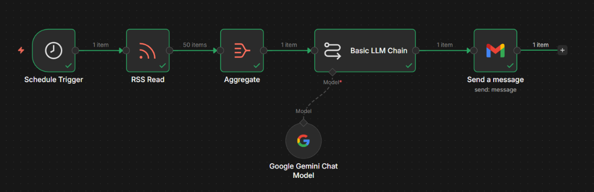

# 📰 Email Automation: Daily AI News Summarizer

An automated n8n workflow that fetches the latest articles from **AI Business**, uses **Google Gemini** to categorize and summarize the top stories, and delivers a scannable daily digest to **Gmail** at **10:00 AM**.



## ⚙️ How It Works

1. **Schedule Trigger:** Triggers automatically every day at **10:00 AM** (`triggerAtHour: 10`).
2. **RSS Read:** Fetches the latest 50 news items from the AI Business RSS feed (`https://aibusiness.com`).
3. **Aggregate:** Combines all fetched items into a single payload, extracting only the `title`, `link`, and `contentSnippet` fields to save tokens.
4. **AI Summarization (`Basic LLM Chain` + `Google Gemini Chat Model`):** Uses **Google Gemini** to select and format the **Top 3 AI News** items and **Top 3 Technology Updates**, complete with ALL-CAPS headlines, 2–3 sentence summaries, and source links.
5. **Send Email (`Send a message`):** Sends the formatted plain-text digest via **Gmail** with the subject line `"AI News"`.

## 🔑 Required Credentials

Configure the following credentials in n8n after importing the workflow:
* **Google Gemini (PaLM) API:** Required for the `Google Gemini Chat Model` node.
* **Gmail OAuth2:** Required for the `Send a message` node to deliver the email digest.

## 🛠️ Setup Instructions

1. Import `workflow.json` into your n8n instance.
2. Open the **Schedule Trigger** node and verify that your n8n instance timezone matches your local **10:00 AM**.
3. Open the **Google Gemini Chat Model** node and attach your Google Gemini API credentials.
4. Open the **Send a message** (Gmail) node, connect your Gmail account, and enter your recipient email address in the **To** field.
5. Click **Test Workflow** to verify that the email arrives in your inbox, then toggle the workflow to **Active**.

## 📧 Sample Output Format

```text
AI NEWS
=======
- ENTERPRISE AI ADOPTION ACCELERATES ACROSS HEALTHCARE
  Hospitals are increasingly deploying generative AI models to streamline clinical documentation and patient triage. Early pilots report significant reductions in administrative overhead while maintaining strict data privacy standards.
  https://aibusiness.com

TECHNOLOGY UPDATES
==================
- NEXT-GEN CLOUD INFRASTRUCTURE TARGETS AI WORKLOADS
  Major cloud providers unveiled new GPU clusters designed to lower inference latency for large language models. The upgrades aim to make real-time AI agents more cost-effective for mid-sized businesses.
  https://aibusiness.com
```
