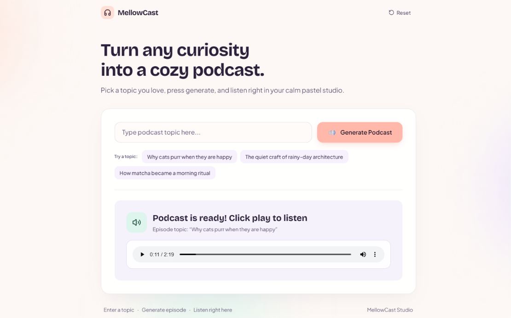
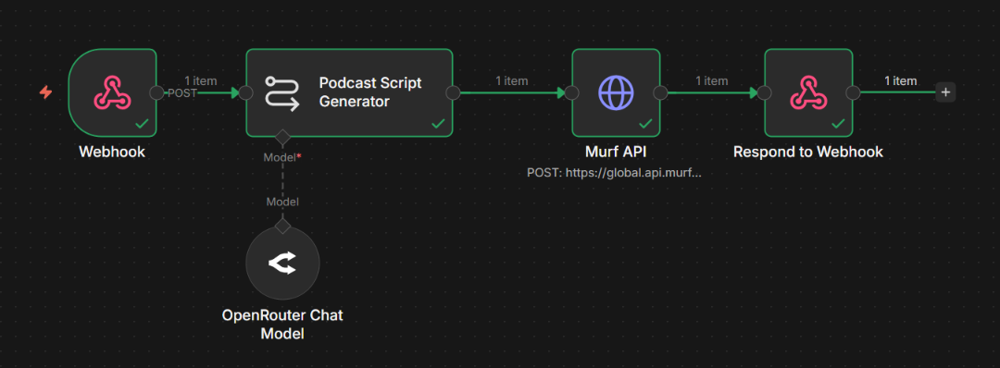

# 🎙️ AI Podcast Generator (Full-Stack Webhook + MellowCast UI)

A full-stack AI podcast generation pipeline connecting a custom web frontend (**MellowCast — Cozy Podcast Studio**, built with Google AI Studio) to an **n8n** backend via Webhooks. Users enter any podcast topic in the web app, which triggers n8n to generate a 2-minute conversational script via **OpenRouter (`google/gemini-2.5-flash-lite`)**, synthesize natural speech using **Murf AI (`falcon-2.1`)**, and stream the binary `.wav` audio file directly back to the browser for playback and download.

## 🖥️ MellowCast Web Interface

* **Frontend App:** [MellowCast — Cozy Podcast Studio](https://mellowcast.ai.studio/) *(Built with Google AI Studio)*
* **Request Format:** Sends a `POST` request to the n8n Webhook URL with a JSON body containing `{ "text": "<Podcast Topic>" }`.
* **Response Handling:** Configured with `responseMode: "responseNode"` and CORS enabled (`Access-Control-Allow-Origin: *`, `Content-type: audio/wav`) to stream playable audio directly into the browser audio player.

## ⚙️ n8n Backend Workflow

1. **Webhook (`POST`):** Listens for incoming JSON payloads (`{{ $json.body.text }}`) sent from the MellowCast frontend interface.
2. **Script Generation (`Podcast Script Generator` + `OpenRouter Chat Model`):** Uses **`google/gemini-2.5-flash-lite`** via **OpenRouter** to write an engaging, ~2-minute conversational podcast script in plain text without formatting labels.
3. **Text-to-Speech Synthesis (`Murf API`):** Sends a `POST` request to `https://murf.ai` using **Murf AI `falcon-2.1`** (`voiceId: Gordon`, `locale: en-US`) to generate the spoken audio stream.
4. **Respond to Webhook:** Returns the binary `audio/wav` file directly to the calling web application with CORS headers enabled.

## 🎧 Sample Output

* Listen to the sample generated episode: [`sample-podcast.wav`](./sample-podcast.wav) *(Topic: "Why cats purr when they are happy" — 2:19 duration)*
* **Excerpt from generated episode:**
  > *"Hey everyone and welcome back to another episode... We all associate that purr with happiness, right? But have you ever stopped to wonder why cats purr when they're happy?"*

## 🔑 Required Credentials & API Keys

Configure the following in n8n after importing the workflow:
* **OpenRouter API:** Required for the `OpenRouter Chat Model` node (`google/gemini-2.5-flash-lite`).
* **Murf AI API Key:** Required in the `Murf API` (HTTP Request) node under the `api-key` header.

## 🛠️ Setup Instructions

1. Import `workflow.json` into your n8n instance.
2. Open the **OpenRouter Chat Model** node and attach your OpenRouter API credentials.
3. Open the **Murf API** (HTTP Request) node and replace `YOUR_MURF_AI_API_KEY` in the `api-key` header with your [Murf AI](https://murf.ai) API key.
4. Toggle the workflow to **Active** and copy the **Production Webhook URL** from the **Webhook** node.
5. Paste your Production Webhook URL into your frontend application (MellowCast / Google AI Studio app) and send a `POST` request with `{ "text": "Your topic" }` to generate and stream your podcast.
