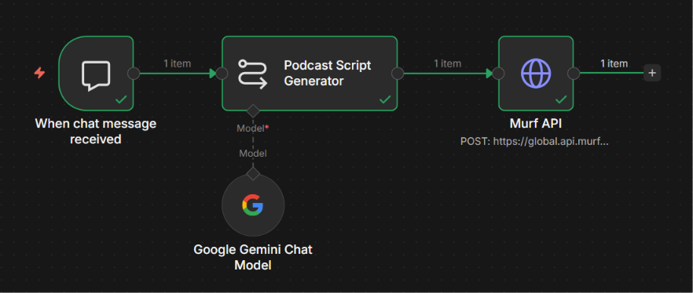

# 🎙️ AI Podcast Generator (Chat to Voice)

An interactive n8n workflow that turns any topic typed into the n8n chat interface into a 2-minute spoken podcast episode using **Google Gemini (`gemini-2.5-flash`)** for scriptwriting and **Murf AI (`falcon-2.1`)** for natural text-to-speech synthesis.

## ⚙️ How It Works

1. **Chat Trigger (`When chat message received`):** Accepts a podcast topic directly from the built-in n8n chat window (e.g., *"AI in Education"*).
2. **Script Generation (`Podcast Script Generator` + `Google Gemini Chat Model`):** Uses **`models/gemini-2.5-flash`** to write an engaging, conversational, ~2-minute spoken podcast script with clean plain text (no stage directions or formatting labels).
3. **Text-to-Speech Synthesis (`Murf API`):** Sends a `POST` request to `https://murf.ai` using the **Murf AI `falcon-2.1`** model (`voiceId: Gordon`, `locale: en-US`) to generate a downloadable audio stream directly inside n8n.

## 🎧 Sample Output

* Listen to the sample generated episode: [`sample-podcast.wav`](./sample-podcast.wav) *(Topic: AI in Education)*
* **Excerpt from generated script:**
  > *"Welcome to Future Class, the podcast exploring innovations shaping tomorrow's learning. Today we're diving into one of the most transformative forces in education: artificial intelligence..."*

## 🔑 Required Credentials & API Keys

Configure the following in n8n after importing the workflow:
* **Google Gemini (PaLM) API:** Required for the `Google Gemini Chat Model` node (`models/gemini-2.5-flash`).
* **Murf AI API Key:** Required in the `Murf API` (HTTP Request) node under the `api-key` header.

## 🛠️ Setup Instructions

1. Import `workflow.json` into your n8n instance.
2. Open the **Google Gemini Chat Model** node and attach your Google Gemini API credentials.
3. Open the **Murf API** (HTTP Request) node and replace `YOUR_MURF_AI_API_KEY` in the `api-key` header with your [Murf AI](https://murf.ai) API key (you can also customize `voiceId` or `locale`).
4. Click **Open Chat** at the bottom of the n8n canvas, enter any podcast topic, and download your generated audio directly from the **Murf API** node output.
