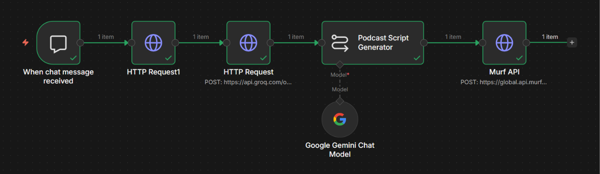

# 🎧 AI Speech-to-Speech (STS) Audio Summarizer

An end-to-end **Speech-to-Speech (STS)** n8n pipeline that accepts any public audio file URL via chat, transcribes the speech (**STT**) using **Groq (`whisper-large-v3-turbo`)**, condenses the transcript into crisp meeting-style action bullet points via **Google Gemini (`gemini-2.5-flash`)**, and converts the summary back into spoken audio (**TTS**) using **Murf AI (`falcon-2.1`)**.

## ⚙️ How It Works

1. **Chat Trigger (`When chat message received`):** Accepts a direct URL to a spoken audio file pasted into the n8n chat window.
2. **Download Audio File (`HTTP Request1`):** Performs a `GET` request to fetch the remote audio file and stores it as binary `data` inside n8n.
3. **Speech-to-Text Transcription (`HTTP Request`):** Sends the binary audio file via `multipart/form-data` to the **Groq Whisper API** (`https://groq.com`, model: `whisper-large-v3-turbo`, `response_format: verbose_json`) to generate a full text transcript.
4. **Precision Summarization (`Podcast Script Generator` + `Google Gemini Chat Model`):** Uses **`models/gemini-2.5-flash`** with strict formatting rules (action verbs, 10–15 words max per bullet, zero filler) to distill the transcript into concise meeting-style minutes.
5. **Text-to-Speech Synthesis (`Murf API`):** Sends the summarized bullet points to `https://murf.ai` (**Murf AI `falcon-2.1`**, `voiceId: Gordon`, `locale: en-US`) to generate a downloadable spoken audio summary.

## 🔊 Sample Input & Output

* **Input Audio:** [`sample-input-audio.mp3`](./sample-input-audio.mp3) *(1m 18s TED Talk clip on short-form internet talks)*
* **Generated Audio Summary:** [`sample-summary-audio.wav`](./sample-summary-audio.wav) *(13s spoken summary)*
* **Generated Summary Transcript:**
  > * Prioritize internet sharing for talk visibility.
  > * Address online audience, not just immediate listeners.
  > * Recognize significantly diminished attention spans since 2009.
  > * Deliver talks quickly, ideally under one minute.

## 🔑 Required Credentials & API Keys

Configure the following in n8n after importing the workflow:
* **Groq API Key:** Required in `HTTP Request` under the `Authorization` header (`Bearer YOUR_GROQ_API_KEY`).
* **Google Gemini (PaLM) API:** Required for the `Google Gemini Chat Model` node (`models/gemini-2.5-flash`).
* **Murf AI API Key:** Required in `Murf API` under the `api-key` header.

## 🛠️ Setup Instructions

1. Import `workflow.json` into your n8n instance.
2. Open **HTTP Request** (Groq Whisper) and replace `YOUR_GROQ_API_KEY` in the `Authorization` header with your [Groq](https://groq.com) API key.
3. Open **Google Gemini Chat Model** and attach your Google Gemini API credentials.
4. Open **Murf API** and replace `YOUR_MURF_AI_API_KEY` in the `api-key` header with your [Murf AI](https://murf.ai) API key.
5. Click **Open Chat**, paste a direct link to any `.mp3` or `.wav` audio file, and download your spoken summary from the **Murf API** node.
