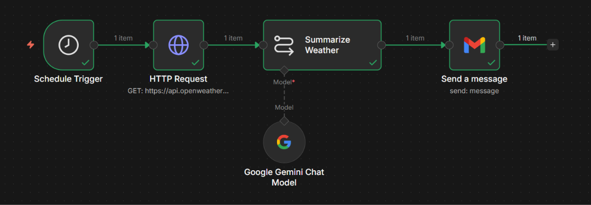
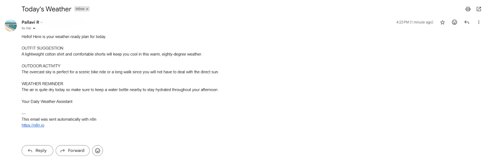

# 🌤️ AI-Powered Weather-Based Daily Planner

An automated n8n daily assistant that fetches live weather data from **OpenWeatherMap**, uses **Google Gemini** to generate a concise, personalized daily plan (including an outfit suggestion, outdoor activity, and weather reminder), and emails it straight to **Gmail** at **1:00 PM**.

## ⚙️ How It Works

1. **Schedule Trigger:** Runs automatically every day at **1:00 PM** (`triggerAtHour: 13`).
2. **Fetch Live Weather (`HTTP Request`):** Queries the **OpenWeatherMap Current Weather API** (`https://openweathermap.org`) for your configured city (`q: bengaluru`) to retrieve temperature, weather description, and humidity.
3. **AI Daily Plan Generation (`Summarize Weather` + `Google Gemini Chat Model`):** Passes `main.temp`, `weather[0].description`, and `main.humidity` to **Google Gemini** with strict formatting rules (under 100 words, clean uppercase section headers, no raw Markdown symbols) to generate:
   * **OUTFIT SUGGESTION:** Practical clothing advice for the current temperature.
   * **OUTDOOR ACTIVITY:** A tailored activity idea suited to the sky and humidity conditions.
   * **WEATHER REMINDER:** A quick hydration, umbrella, sunscreen, or jacket tip.
4. **Send Email (`Send a message`):** Delivers the plain-text daily plan via **Gmail** with the subject `"Today's Weather"`.

## 📧 Sample Gmail Output

## 🔑 Required Credentials & API Keys

Configure the following in n8n after importing the workflow:
* **OpenWeatherMap API Key:** Free API key from [OpenWeatherMap](https://openweathermap.org) entered in the `HTTP Request` node under the `appid` query parameter.
* **Google Gemini (PaLM) API:** Required for the `Google Gemini Chat Model` node.
* **Gmail OAuth2:** Required for the `Send a message` node to send the daily email.

## 🛠️ Setup Instructions

1. Import `workflow.json` into your n8n instance.
2. Open the **Schedule Trigger** node and adjust the hour (`triggerAtHour`) and timezone to match when you want your daily brief delivered.
3. Open the **HTTP Request** node, replace `bengaluru` in the `q` parameter with your city, and paste your **OpenWeatherMap API key** into the `appid` parameter.
4. Open the **Google Gemini Chat Model** node and attach your Google Gemini API credentials.
5. Open the **Send a message** (Gmail) node, connect your Gmail account, and enter your recipient email address in the **To** field.
6. Click **Test Workflow** to verify that the email arrives cleanly, then toggle the workflow to **Active**.
