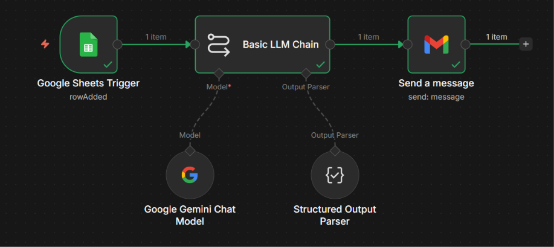
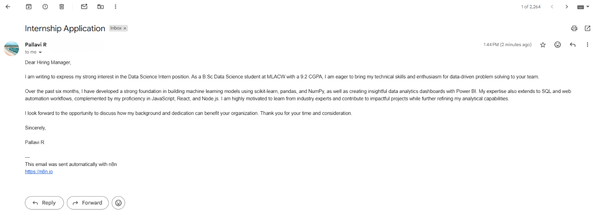

# 🎓 Auto AI Internship Applier

An automated n8n workflow that monitors a Google Sheet for newly added internship applications, generates a tailored, ready-to-send internship inquiry email using **Google Gemini** with a **Structured Output Parser**, and sends it directly via **Gmail**.

## ⚙️ How It Works

1. **Google Sheets Trigger (`rowAdded`):** Checks `Sheet1` of the connected Google Sheet (`Auto AI Internship Applier`) daily at **10:00 AM** for newly added rows.
2. **AI Application Email Drafting (`Basic LLM Chain`):** Passes candidate details (`Name`, `Email`, `Internship Role`, `Details`, `Experience`, and `Skills`) to **Google Gemini** to write a polite, enthusiastic, and ready-to-send email without any placeholder brackets.
3. **Structured Output Parser:** Formats the AI response into a clean JSON schema containing `to`, `subject`, and `body` fields so downstream nodes can map them reliably.
4. **Send Email (`Send a message`):** Sends the generated email body (`{{ $json.output.body }}`) via **Gmail**. *(Configured by default to send to your own inbox for safe review/testing; switch the **To** field to `{{ $json.output.to }}` to email recruiters directly).*

## 📊 Google Sheet Setup

Create a Google Sheet (`Sheet1`) with the exact 6 column headers below before running the workflow:

| Name | Email | Internship Role | Details | Experience | Skills |
| :--- | :--- | :--- | :--- | :--- | :--- |
| `Pallavi R` | `hr@company.com` | `Data Science Intern` | `B.Sc Data Science student, 9.2 CGPA` | `6 months ML & analytics projects` | `Python, scikit-learn, pandas, NumPy, Power BI, SQL` |

## 📧 Sample Email Output

## 🔑 Required Credentials

Configure the following credentials in n8n after importing the workflow:
* **Google Sheets Trigger OAuth2:** Required to detect newly added rows in your spreadsheet.
* **Google Gemini (PaLM) API:** Required for the `Google Gemini Chat Model` node.
* **Gmail OAuth2:** Required for the `Send a message` node to send the application email.

## 🛠️ Setup Instructions

1. Create a Google Sheet named `Auto AI Internship Applier` with the 6 column headers listed above.
2. Import `workflow.json` into your n8n instance.
3. Open the **Google Sheets Trigger** node, connect your Google account, and select your Spreadsheet (`Document`) and `Sheet1`.
4. Open the **Google Gemini Chat Model** node and attach your Google Gemini API credentials.
5. Open the **Send a message** (Gmail) node, connect your Gmail account, and set the **To** field to your test email (or `={{ $json.output.to }}` for live sending).
6. Add a test row to your Google Sheet, click **Test Workflow** to inspect the drafted email, and toggle the workflow to **Active**.
