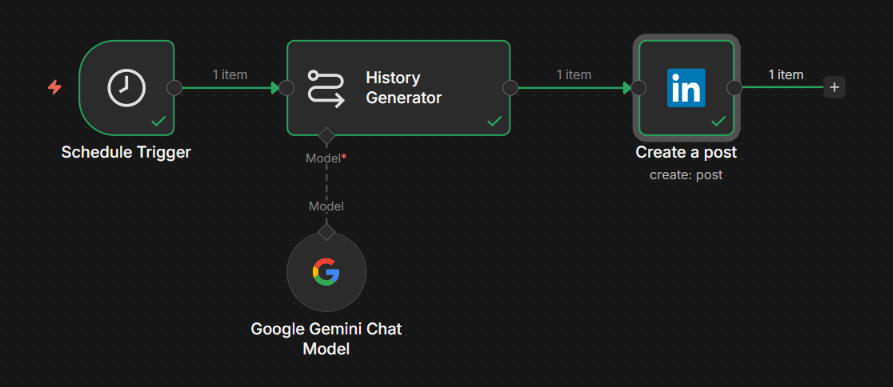

# 📜 Automated Historical Content Publisher (LinkedIn)

An automated n8n social media workflow that dynamically reads today's date, uses **Google Gemini** to find a significant historical event from **"On This Day in History"**, crafts an engaging LinkedIn post with a discussion hook, and publishes it automatically to your **LinkedIn** profile every day at **1:00 PM**.

## ⚙️ How It Works

1. **Schedule Trigger:** Runs automatically every day at **1:00 PM** (`triggerAtHour: 13`).
2. **History Generator (`Basic LLM Chain` + `Google Gemini Chat Model`):** Passes the dynamic current date (`{{ $now.toFormat('MMMM d') }}`) to **Google Gemini** with structured formatting instructions to:
   * Identify a notable historical event that occurred on the current calendar date.
   * Open with a strong hook (`"On this day in [Year]..."`).
   * Explain the event and its broader historical or economic impact while referencing the present date.
   * Close with an engaging question to drive comments and add `#OnThisDay`, `#History`, and `#TodayInHistory`.
3. **Auto-Publish (`Create a post`):** Publishes the clean, ready-to-read post text (`{{ $json.text }}`) directly to your personal **LinkedIn** profile.

## 📱 Sample Live LinkedIn Output

## 🔑 Required Credentials

Configure the following credentials in n8n after importing the workflow:
* **Google Gemini (PaLM) API:** Required for the `Google Gemini Chat Model` node.
* **LinkedIn OAuth2:** Required for the `Create a post` node to publish directly to your profile.

## 🛠️ Setup Instructions

1. Import `workflow.json` into your n8n instance.
2. Open the **Schedule Trigger** node and verify that your n8n instance timezone matches your local **1:00 PM** (`triggerAtHour: 13`).
3. Open the **Google Gemini Chat Model** node and attach your Google Gemini API credentials.
4. Open the **Create a post** (LinkedIn) node, connect your LinkedIn OAuth2 account, and select your profile under **Person**.
5. Click **Test Workflow** to verify that the post publishes properly to LinkedIn, then toggle the workflow to **Active**.
