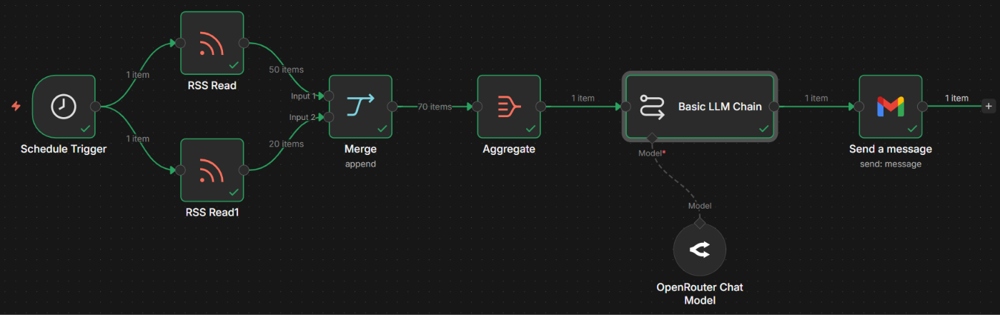

# 📰 Daily AI & Tech News Digest (to Gmail)

An automated n8n workflow that pulls the latest stories from **AI Business** and **TechCrunch**, merges and aggregates the feeds, summarizes the top news using **OpenRouter (`openai/gpt-4o-mini-2024-07-18`)**, and delivers a structured daily brief to **Gmail** at **10:00 AM**.



## ⚙️ How It Works

1. **Schedule Trigger:** Runs automatically every day at **10:00 AM** (`triggerAtHour: 10`).
2. **Dual RSS Feed Ingestion (`RSS Read` & `RSS Read1`):** Fetches the latest articles in parallel from two sources:
   * **AI Business:** `https://aibusiness.com` (50 items)
   * **TechCrunch:** `https://techcrunch.com` (20 items)
3. **Merge (`append`):** Combines both RSS streams into a single list of 70 items.
4. **Aggregate:** Consolidates all 70 items into one payload, keeping only `title`, `link`, and `contentSnippet` to optimize token usage.
5. **AI Summarization (`Basic LLM Chain` + `OpenRouter Chat Model`):** Uses **`openai/gpt-4o-mini-2024-07-18`** via **OpenRouter** with strict grounding instructions (no hallucinated content) to curate up to **3 AI News** items and up to **3 Technology Updates**.
6. **Send Email (`Send a message`):** Delivers the formatted plain-text brief via **Gmail** with the subject `"AI News"`.

## 🔑 Required Credentials

Configure the following credentials in n8n after importing the workflow:
* **OpenRouter API:** Required for the `OpenRouter Chat Model` node (`openai/gpt-4o-mini-2024-07-18`).
* **Gmail OAuth2:** Required for the `Send a message` node to send the daily email.

## 🛠️ Setup Instructions

1. Import `workflow.json` into your n8n instance.
2. Open the **Schedule Trigger** node and verify that your n8n timezone matches your local **10:00 AM**.
3. Open the **OpenRouter Chat Model** node and attach your OpenRouter API credentials.
4. Open the **Send a message** (Gmail) node, connect your Gmail account, and enter your recipient email address in the **To** field.
5. Click **Test Workflow** to verify the email delivery, then toggle the workflow to **Active**.

## 📧 Sample Email Output

```text
Hi there,
Here's your Tech Brief:

AI NEWS
=======
ENTERPRISE AI AGENTS STREAMLINE CUSTOMER OPERATIONS
Companies are deploying multi-step AI agents to resolve routine support tickets automatically. Early adopters report faster response times and lower operational costs.
Link: https://aibusiness.com

TECHNOLOGY UPDATES
==================
NEXT-GEN CLOUD CHIPS TARGET LOWER INFERENCE COSTS
Major hardware makers introduced new data center processors built specifically for running large language models efficiently. The upgrades aim to make real-time AI features more accessible to startups.
Link: https://techcrunch.com
```
