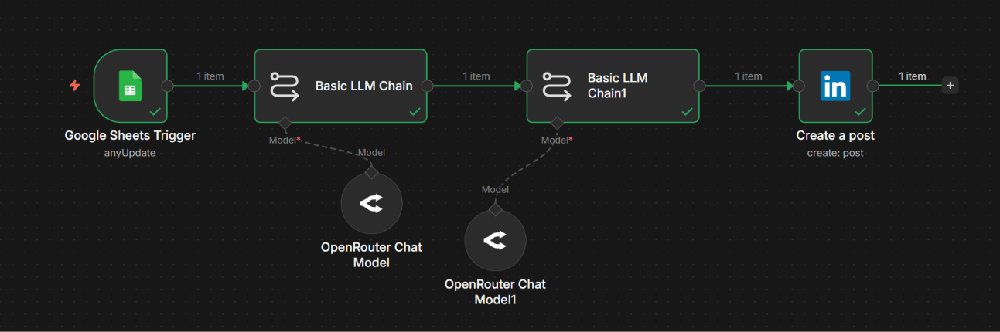

# 💼 AI LinkedIn Post Generator (from Google Sheets)

An automated n8n workflow that turns article links stored in Google Sheets into ready-to-publish, high-engagement LinkedIn posts using AI.

## ⚙️ How It Works

1. **Trigger:** Monitors a connected **Google Sheet** for new rows containing an article URL (or runs on a schedule to process rows marked `Pending`).
2. **Extract Article Content:** Uses an **HTTP Request / HTML Extract** node (or web scraper) to fetch the full text of the article from the provided URL.
3. **Generate Post:** Sends the article text to **[AI Model, e.g., OpenAI GPT-4o / Claude / Gemini]** with a custom system prompt to write a hook, key takeaways, and relevant hashtags.
4. **Save / Publish:** Writes the generated draft back into the Google Sheet (and/or publishes directly to LinkedIn) and updates the row status to `Done`.

## 📊 Google Sheet Setup

Create a Google Sheet with the following column headers before running the workflow:

| Article URL | Status | Generated Post | Date |
| :--- | :--- | :--- | :--- |
| `https://example.com` | `Pending` | *(Auto-filled by n8n)* | *(Auto-filled)* |

## 🔑 Required Credentials

* **Google Sheets OAuth2:** Access to read URLs and update row statuses.
* **LLM API Key:** [OpenAI / Google Gemini / Anthropic] API credentials.
* *(Optional)* **LinkedIn OAuth2:** Required if you enable automatic publishing instead of saving drafts to Sheets.

## 🛠️ Setup Instructions

1. Create a Google Sheet matching the table layout above.
2. Import `workflow.json` into n8n.
3. Open the **Google Sheets** nodes, connect your Google account, and select your Spreadsheet ID and Sheet Name.
4. Open the **AI / LLM** node and attach your API credentials.
5. Add a test article URL to your sheet, run a manual test, and toggle the workflow to **Active**.

## 📝 Example Generated Post

> 🚀 **AI agents are shifting from chatbots to autonomous workers.**
>
> A new report highlights how teams are cutting manual ops by 60% using event-driven workflows:
> • Automated triage handles repetitive requests before humans step in
> • Structured tool-calling keeps outputs reliable and auditable
> • Human-in-the-loop gates ensure safety on critical actions
>
> Which daily task would you automate first? 👇
>
> #AI #Automation #n8n #Productivity #TechTrends
