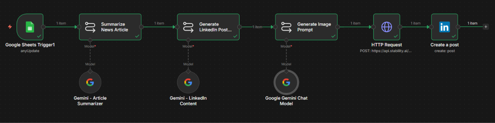

# 🎨 Multimodal AI LinkedIn Post & Image Generator

An end-to-end multimodal n8n automation workflow that monitors a Google Sheet for new article links, summarizes the article and drafts an industry-expert LinkedIn post using **Google Gemini**, generates a custom visual prompt and renders an AI image via **Stability AI**, and auto-publishes the complete text + image post to **LinkedIn**.

## ⚙️ How It Works

1. **Google Sheets Trigger (`Google Sheets Trigger1`):** Polls `Sheet1` in your connected Google Sheet (`Automation`) every minute for updates or newly added rows containing an `Article link`.
2. **Article Summarization (`Summarize News Article`):** Passes the `Article link` to **Google Gemini** to extract a concise summary of the article.
3. **LinkedIn Post Drafting (`Generate LinkedIn Post Content`):** Uses a second **Google Gemini** chain acting as an industry expert to turn the summary into a structured, under-3,000-character LinkedIn post with hashtags and a call to action.
4. **Visual Prompt Engineering (`Generate Image Prompt`):** Uses **Google Gemini (`models/gemini-2.5-flash`)** to convert the post summary into a concise (max 50 words), descriptive visual prompt tailored for modern tech/business imagery.
5. **AI Image Generation (`HTTP Request`):** Sends a `POST` request (`multipart/form-data`) to the **Stability AI Core API** (`https://stability.ai`) to generate a binary `.jpeg` image file.
6. **Auto-Publish Image Post (`Create a post`):** Combines the generated LinkedIn copy (`{{ $('Generate LinkedIn Post Content').item.json.text }}`) with the binary image (`shareMediaCategory: IMAGE`) and publishes directly to your **LinkedIn** profile.

## 📊 Google Sheet Setup

Create a Google Sheet (`Sheet1`) with the exact column header below before running the workflow:

| Article link |
| :--- |
| `https://example.com` |

## 📱 Sample Live LinkedIn Output

## 🔑 Required Credentials & API Keys

Configure the following in n8n after importing the workflow:
* **Google Sheets Trigger OAuth2:** Required to detect new article links in your spreadsheet.
* **Google Gemini (PaLM) API:** Required for all three Gemini language model nodes (`Summarize News Article`, `Generate LinkedIn Post Content`, and `Generate Image Prompt`).
* **Stability AI API Key:** Required in the `HTTP Request` node under the `Authorization` header (`Bearer YOUR_STABILITY_AI_API_KEY`).
* **LinkedIn OAuth2:** Required for the `Create a post` node to publish text + image posts.

## 🛠️ Setup Instructions

1. Create a Google Sheet with a column named **`Article link`**.
2. Import `workflow.json` into your n8n instance.
3. Open **Google Sheets Trigger1**, connect your Google account, and select your Spreadsheet (`Document`) and `Sheet1`.
4. Open all three **Google Gemini** nodes and attach your Google Gemini API credentials.
5. Open the **HTTP Request** node and replace `YOUR_STABILITY_AI_API_KEY` in the `Authorization` header with your Stability AI key.
6. Open the **Create a post** (LinkedIn) node, connect your LinkedIn OAuth2 account, and select your profile under **Person**.
7. Add a test article URL to your Google Sheet, click **Test Workflow** to verify both the text and generated image, and toggle the workflow to **Active**.
